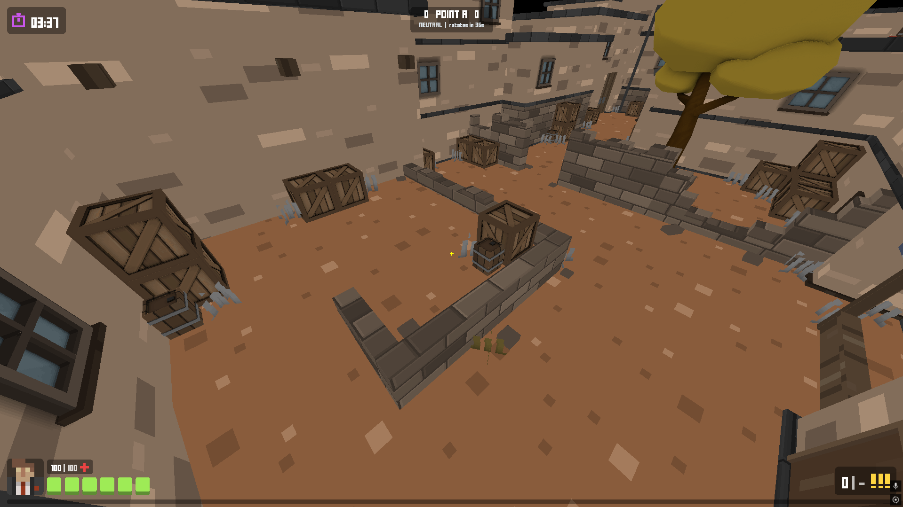

# Krodin

A Krunker.io Fantasy - A rewrite of the game to target direct binaries. Initially ported into a native-C
implementation, but has been fully ported and removed for the sake of simplicity and ease of development. The entire engine lives in `src/` and is now built
with Odin! 



> [!NOTE]
> The Odin port is actively developed. The client starts on a connection screen and exposes an explicit
> **Join** action beside an editable invite field. Paste a link, join the lobby,
> choose a team and class, then select **Enter Game**. **Local practice** starts an offline session for network experiments.
> Competitive and Ranked sessions use the team-roster lobby. Ordinary sessions and Local practice
> use a compact Play menu with a **Change class** overlay; manual team controls appear when allowed.
> Pick a class to open its loadout, showing its primary and available secondaries:
> Pistol, Desert Eagle, Alien Blaster, Sawed Off, Auto Pistol and Techy-9.
> Choose a secondary there, then select **Done** to return to the lobby.
> Changes made while alive apply on the next spawn; live lobbies confirm the loadout.
>
> The native protocol is project-owned and intentionally targets only this native client and
> dedicated server.

## Browser access on Windows

Click **Login** on the connection screen or under **Session / Invite** to log in
before entering an invite. Login opens the browser, caches access, and leaves you
in the current session. Later, paste an invite and press **Join** to use that access.
You can also press **Join** directly to log in and continue with the same invite.
Both actions use the official site in an embedded WebView2 window. Krodin waits for
a nonempty `krunker_username` in the official page's localStorage, then waits one
second for the login handler to finish writing account access before reading
`__FRVR_auth_access_token`. The JWT payload is decoded to reject `platform` values
of `anonymous` or `anon`, including `extra.platform`, even with a username flag or
`verified: true`. Guest access keeps the browser open for account login. Only the access token passes
to the native client; refresh credentials remain in the browser session.
The first session is visible. Later refreshes start hidden
and show the window when login or other interaction is needed. Log in through the
site's normal login flow; **Cancel** or closing the browser cancels Join.
The original invite continues automatically when access is ready. Duplicate Join
requests are disabled while access is pending.

Install the [Microsoft Edge WebView2 Evergreen Runtime](https://developer.microsoft.com/microsoft-edge/webview2/)
if Join reports that it is missing. Startup, Local practice, and direct native-server
connections work offline. The helper opens only after **Login** or a Join that needs access or verification. macOS and Linux retain their
existing environment/`.env` token method and have no browser dependency.

Krodin uses a separate `%LOCALAPPDATA%\Krodin\Browser` profile. It stores the access
JWT in `%LOCALAPPDATA%\Krodin\access-account.dpapi`, encrypted for your Windows user with DPAPI.
Refresh credentials stay in the browser profile. **Session / Invite ? Forget browser
session** clears both; close other Krodin browser windows first. This does not sign out
your regular browser or interrupt an established game connection.

The browser token is reused until 60 seconds before its JWT expiry. Decoded expiry only
schedules renewal; the server decides acceptance. This Windows test build uses
browser access only: `KRUNKER_ACCESS_TOKEN` from the environment or `.env` is ignored.
macOS and Linux retain their existing environment/`.env` token method.
An explicit invalid/expired-token response invalidates the token and retries the same
invite with browser access once. Generic permission/403 failures do not trigger refresh.
If the official page does not expose `FRVR.auth.getFreshAccessToken()`, Join reports the
failure and asks you to retry Login after the site loads. Account UI and ranked account management
remain deferred.

If `/seek-game` returns `CaptchaRequired`, Windows Join opens the verification
helper for the same invite. Complete any challenge there. The helper holds the
proof-bearing request before it reaches matchmaking and blocks the page's game
WebSocket. It passes the proof over private IPC, closes, and Odin retries native
matchmaking once. When the browser receives a successful assignment without a
captcha token, it hands the validated assignment to the same native WebSocket
path instead of leaving the game running only in the helper. Gameplay uses the
existing native WebSocket. This handoff is experimental: acceptance of the proof
outside its browser session still needs a live test. A second CAPTCHA response
stops the attempt without another prompt.

Login and Join print authentication stages to the console and
`logs/krunker-network.log`, including request IDs, elapsed time, username-gate waits,
SDK renewal, cache reuse, cancellation, errors, and Join continuation. Tokens,
refresh credentials, usernames, and login response bodies are omitted. Launch
`.\bin\krodin_client.exe` from PowerShell to watch the console, or follow the file
from another terminal with `Get-Content .\logs\krunker-network.log -Wait -Tail 40`.

For a standalone embedded browser with full DevTools and a redacted network
timeline, see [the browser inspector](tools/browser_inspect/README.md). Build with
`build.bat inspect none`, then run
`python -B tools/browser_inspect/inspect_browser.py "https://krunker.io/?game=NY:066nj"`.
It uses its own browser profile and runs independently of the game client.

## Requirements

- The [Odin compiler](https://odin-lang.org/) and a working system linker.
- A GPU and driver with OpenGL 4.5 core support to run the client. See the
  [GPU compatibility notes](doc/supported-gpus.md) for example hardware families and driver guidance.
- The original game assets described below. The dedicated server does not need the model, texture,
  sound, or font assets.

## Asset setup

The repository includes maps, shaders, configuration, and UI images, but the full runtime asset
pack is not tracked. Before starting the client, unpack a compatible Krunker `mod.zip` into
`assets/` so these paths exist:

- `assets/models/`
- `assets/textures/`
- `assets/sound/`

HUD and menu text use the bundled Rajdhani SemiBold font; its license is included
in `assets/css/fonts/Rajdhani-OFL.txt`.

The current asset pack is recommended for the v3 map. Keep the files already present in `assets/`; see
the [asset instructions](assets/README.md) for details.

## Building

The port has one build toolchain: **Odin** (`make` is just a thin wrapper). The repository does not
vendor or build separate C dependencies; GLFW, OpenGL, and the image/font loaders come from Odin's
own `vendor/` bindings.

Audio uses Odin's bundled `vendor:miniaudio`, with MP3 decoding and stereo
positional playback. Windows includes the static library. On a fresh Linux or
macOS Odin install, build that library once before building the client:

```bash
sh "$(odin root)/vendor/miniaudio/src/build_miniaudio.sh"
```

This uses a C compiler and the platform's system audio APIs; no audio DLLs need
to be shipped with the Windows client.

### Linux

On Debian or Ubuntu, install GLFW and its `pkg-config` metadata:

```bash
sudo apt install pkg-config libglfw3 libglfw3-dev
```

Use your distribution's equivalent packages elsewhere. That's the whole build-time dependency list. 

> **Fresh Odin installs only:** Odin ships the STB image/truetype libraries as source, and on
> Linux their prebuilt archives are generated locally. If `odin build` panics with
> *"Could not find the compiled STB libraries"*, run once:
>
> ```bash
> make -C "$(odin root)/vendor/stb/src"
> ```
>
> This needs a C compiler + `ar` (`build-essential` or gcc/clang + binutils).

Then:

```bash
make          # build client and server
make client   # build bin/krodin_client
make server   # build bin/krodin_server
make check    # type-check client and server
make test     # build and run the deterministic simulation tests
```

### Windows

Odin's `vendor:glfw` statically links the shipped
`glfw3_mt.lib` (no DLL needed), `vendor:stb` uses pre-shipped `.lib` files, and OpenGL is loaded at
runtime. You need the Odin compiler and a working Windows linker (MSVC or MinGW-w64).
Windows client builds also build `krodin_browser.exe` and restore the official Microsoft
WebView2 loader from a pinned, checksum-verified NuGet package. The first build needs internet access.
The helper and `WebView2Loader.dll` must stay beside the client executable; packaging includes
both and Microsoft?s license and notices. `build.bat browser none` builds just the helper.

Build from PowerShell or cmd with the bundled helper. The leading `.\` works in both shells:

```bat
.\build.bat
.\build.bat client
.\build.bat server
.\build.bat tests
.\build.bat check
.\build.bat clean
```

Pass an optimization level after the build target: `none`, `minimal`, `size`,
`speed`, or `aggressive` (the default). For `all`, a third argument sets the server
level separately; otherwise both binaries use the same level.

```bat
.\build.bat client speed
.\build.bat server minimal
.\build.bat tests none
.\build.bat all speed minimal
```

To build the client and server and package them with the minimum curated runtime assets, run:

```powershell
.\package-windows.ps1
```

The packager uses `Krodin-Windows.zip` as its asset seed (also accepting the legacy
`KrunkNative-Windows.zip` filename), then adds the current binaries,
configuration, and current models, textures, icons and sights for every supported weapon.
Both packagers use `assets/config/weapon-assets.txt` to refresh weapon assets from your installed pack.
Use `-SkipBuild` to package existing binaries or `-AssetArchive`
to provide another curated runtime archive.

With no target, the script builds both binaries. The other targets build the client or server,
run the tests, type-check both programs, or remove generated binaries, respectively.

If you ever build the client with `-define:GLFW_SHARED=true`, copy
`vendor/glfw/lib/glfw3.dll` from the directory reported by `odin root` next to the executable.

## Running

Run the binaries from the repository root so every asset path resolves consistently.

### Audio

Weapon and melee attacks, reloads, swaps, footsteps, jumps, landings, slides,
world impacts, explosions, damage and confirmed hits use the installed sounds
in `assets/sound/`. Remote effects use the camera's position and orientation for
stereo direction and distance attenuation. Movement reconciliation and local
shot echoes do not repeat sounds. Live hit sounds require server confirmation.

Settings provides Master, Effects, Footsteps and UI volume sliders. Drag them or
use Left/Right with keyboard focus; Tab scrolls controls into view. Select Save
to apply changes and persist them to the ignored `audio-settings.json` beside the
working directory's assets folder. Zero Master volume mutes all output.

Short effects are decoded at startup from `assets/config/sound-assets.txt` and
share a bounded pool of 64 voices; both packagers refresh those assets. Weapon
`sound` configuration supports a sound name (for example `weapon_4`) or an asset
path (for example `mods/weapons/fire.wav`). Missing effects are logged once and
remain silent. If no output device is available, the client continues silently.

### Offline

```bash
./bin/krodin_client --offline
```

On Windows, use `.\bin\krodin_client.exe --offline`.

Shotgun, Sawed Off and Rocket Launcher shots boost you away from nearby map
surfaces. Aim at the floor to gain height or at a wall to push away from it;
the boost weakens with distance. Servers can adjust it with `impulseMlt`
(or `[game] impulse_mlt` in native configuration).

### Local multiplayer

Start the server in one terminal, then start one or more clients from other terminals:

```bash
./bin/krodin_server
./bin/krodin_client
```

On Windows, use `.\bin\krodin_server.exe` and `.\bin\krodin_client.exe`. The
client remains offline until the join control is used. Passing `--map` always starts a local
custom-map session.

### Joining a lobby link

Copy a Krunker invite (`https://krunker.io/?game=<id>`) and choose **PASTE & JOIN LINK** on the
home screen. The client parses browser invite links, assigned game URLs, and direct `tcp://host:port`
endpoints without probing a server at startup. Browser invites are resolved through the matchmaker,
then the live adapter keeps a libcurl WSS connection open and sends the MessagePack load/team/class/
spawn bootstrap. Use **Login** for browser access on Windows. On macOS/Linux, set
`KRUNKER_ACCESS_TOKEN` in the ignored `.env` (or in the environment) for browser
invite resolution. Direct `wss://` links are accepted as well; offline sessions continue to use the
existing local renderer and simulation.

Live joins reassemble complete WebSocket messages before decoding, load the server's
official map (including the Sandstorm v3 alias), and attach the camera/view model only
after `start` and a matching local player position arrive. Team/class entry waits for
`ready` and sends the bootstrap in paced steps. If the server reports `gmsg("wt")`,
the menu shows that it is waiting for players; that state has no confirmed spawn yet.
After spawning, keyboard/mouse input is sent as live `q` batches with local prediction
and authoritative position corrections.

Live match clocks/scores, objectives, team and round changes, movement locks,
player flags, interaction progress, hit confirmations, and standard projectile
notifications are also handled. See [packet coverage](doc/live-packets.md) for
supported schemas, validation, and remaining protocol work.

Join diagnostics are always enabled in the client. Launch `.\bin\krodin_client.exe`
from this worktree directory, retry **PASTE & JOIN LINK**, and inspect
`logs/krunker-network.log` (also printed to the console). Each attempt records the parsed
invite, token source/expiry, matchmaker URLs, HTTP status/response headers/error body,
curl DNS/TLS details and timings, WebSocket upgrade, and MessagePack spawn stages.
Credentials and cookies are redacted. Error bodies are limited to 16 KiB per log entry;
routine frame/opcode details are limited to the first 40 frames to control log volume.
The log appends across runs and is ignored by Git. The on-screen error includes the HTTP
status and a short server response excerpt.

The diagnostic regression test uses a local HTTP server and needs no account or lobby:

```powershell
odin build tools/network_diagnostics_test -out:bin/network_diagnostics_test.exe -o:none
python tools/test_network_diagnostics.py
# Optional: tests the map/player handoff using a hidden OpenGL window.
odin test src/client -out:bin/krodin_client_tests.exe
```

The standalone flow diagnostic requires a fresh `KRUNKER_ACCESS_TOKEN` because the `/seek-game`
endpoint rejects anonymous requests. It reads that variable from the environment first, then from
the local `.env` file. It fetches a validation token, resolves the invite, builds the assigned WSS
URL, and probes the TLS WebSocket upgrade without sending gameplay packets.

To run the standalone link-flow diagnostic, build it as a single Odin file and pass one copied
link. It prints each stage and exits nonzero at the exact failing stage:

```powershell
odin build tools/krunker_link_flow_test.odin -file -out:bin/krunker_link_flow_test.exe -o:none
# The diagnostic loads KRUNKER_ACCESS_TOKEN from .env in the current directory.
.\bin\krunker_link_flow_test.exe "https://krunker.io/?game=<id>"
```

For protocol experiments, see `experiments/python_link_flow/README.md`. Its
`--packets` mode sends the initial MessagePack `load` packet and logs decoded
server frames and trailer values.

### Client options

| Option | Description |
| --- | --- |
| `-m, --map <name>` | Load a specific map, such as `ss_v3`. |
| `-c, --class <name>` | Preselect a class, such as `hunter`. |
| `--offline` | Skip the server connection and run the authoritative simulation locally. |
| `--fps` | Show the FPS meter. |
| `-h, --help` | List every available map and class. |

You can also choose a class on the spawn screen before entering the game.

All 47 official map IDs (0–46) are registered with their server IDs. Refresh
them with `python download_maps.py`, or refresh selected maps with
`python download_maps.py --ids 2 4`. The downloader validates each response,
replaces older maps, and skips identical files. Sandstorm keeps the
`sandstorm_v3.json` asset filename; the obsolete export is removed after a
successful download. Both release packagers include the refreshed map files.
Use `--offline --map candy_heist` (or another name from `--help`) to open one
directly. The practice rotation contains Burg, Sandstorm, Undergrowth, Subzero,
Industry, Site, Bureau, and Frontier.

Importing a map does not add its browser scripts or new renderer features.
Custom assets outside the bundled OBJ registry, including GLB/glTF/FBX assets,
are currently omitted. Surface variant numbers outside the browser texture
registry use the base texture directly. The map geometry, spawn points, and environment data are
retained in the downloaded JSON.

Scoped weapons hide the first-person weapon and hands at full ADS and use the
bundled default scope image. All class primary models are registered, including
Crossbow, Build Tool, and Charge Rifle. Building and weapon charge mechanics
still require a separate gameplay implementation.

## Controls

Settings > Key binds provides Primary and Alternate slots for each action.
Select a slot and press a key or mouse button; either slot activates the action.
Escape cancels capture, Delete clears the slot, and backtick is reserved for
practice map rotation. Escape always remains available for menus.

Main uses a manually entered Mouse DPI and sensitivity in cm/360. Click either
value to type, then press Enter or Tab to confirm. DPI changes preserve the
selected physical sensitivity. FOV changes preserve true hipfire cm/360: the same
mouse distance produces the same turning angle at every FOV. Enable Advanced
sensitivity to reveal a separate ADS cm/360 value; fully aimed ADS then uses that
distance for every weapon zoom, with a smooth transition from hipfire. With Advanced
off, ADS retains the existing zoom scaling. Invert mouse reverses vertical look only.
DPI changes preserve both physical sensitivity values. Existing settings keep their
camera turn speed and start with an editable DPI of 800. Save applies these values;
Cancel discards the edits.

Save applies all edited categories; Cancel or Escape discards the draft. Key
bindings, sensitivity, graphics and HUD preferences persist in the ignored
`client-settings.json` in the working directory. Video supports mode, monitor,
window resolution, V-Sync, sharp/smooth texture filtering and supported anisotropic
filtering levels. Visuals provides brightness, gamma, contrast, saturation
and ambient/sunlight strength. Fog distance and environment colors follow the
map and cannot be overridden in Settings. Graphics preview live; Cancel or Escape restores
the saved appearance. Reset visuals restores the original map appearance.
Gameplay starts with a vertical world field-of-view slider (60–120 degrees,
default 90). Save applies and persists it; Cancel discards the draft. Weapon
field of view remains separate.
HUD independently toggles the timer (including
objective/phase countdowns), current-round objective points, rounds won and FPS.
The default bindings are:

| Input | Action |
| --- | --- |
| `W`, `A`, `S`, `D` | Move |
| Mouse | Look |
| Left mouse button | Fire |
| Right mouse button | Aim or scope |
| `Space` | Jump |
| Left `Shift` | Crouch or slide |
| `R` | Reload |
| `E` / `Q` | Switch to the secondary / melee weapon |
| `Esc` | Release the mouse cursor |
| `F11` | Toggle fullscreen |

Run N Gun, Agent, and Runner can also wall jump: jump beside a wall, release
`Space`, then press it again while touching the wall to kick away. Holding
`Shift` while falling against a wall slows your descent. Maps can disable wall
jumping on individual surfaces; ramps, cylinders, and ladders do not count as
walls for this ability.

## Runtime dependencies (Linux)

- `libglfw3` is the only required runtime library. It pulls in the X11/Wayland/GLX/EGL runtime
  libraries automatically on a desktop.
- For **headless/CI machines or software rendering**, also install `libgl1 libgl1-mesa-dri`
  (the client requests an OpenGL 4.5 core context, which Mesa's `llvmpipe` satisfies).
- OpenGL itself needs no package — the client loads every GL entry point at runtime via GLFW.

## Gameplay configuration

Class defaults come from [`krunker-configs/class-configs.json`](krunker-configs/class-configs.json).
The client and server embed that registry at build time and read the runtime copy when present,
so packaged builds use the same class data even without the JSON file beside them.

Weapons and match rules are configured in [`assets/config/game.toml`](assets/config/game.toml).
Named sections apply partial overrides, including optional custom class settings, after the JSON
defaults:

```toml
[game]
tick_rate = 64
score_limit = 250

[weapons.ak47]
name = "Assault Rifle"
src = "weapon_2"
damage = 23.0

[classes.trooper]
loadout = ["awp"]
```

The same file controls the match timer, objective rotation and scoring, regeneration, respawning,
and player limit. The standard map rotation is `burg`, `sandstorm`, `undergrowth`, `subzero`,
`industry`, `site`, `bureau`, and `frontier`; all other bundled maps remain available for local play through `--map`. The class
picker uses the standard nine-class pool, while every configured class remains addressable through
`--class` for custom play.

## Testing

The headless test executable exercises the authoritative server path and the client prediction
path against the same fixed-timestep simulation. It covers map collision, gravity, floor and wall
blocking, jump replay, remote interpolation, packet validation, loadouts, weapon timing, damage,
respawning, objective scoring, and all recorded movement scenarios.

```bat
.\build.bat tests
```

The client renderer still requires a GPU and a window; presentation-only behavior should be
verified separately from the deterministic headless suite.

## Project layout

| Path | Contents |
| --- | --- |
| `src/client/` | OpenGL client, UI, audio, input, and client networking |
| `src/server/` | Dedicated authoritative server and TCP networking |
| `src/shared/` | Simulation, maps, configuration, types, and native network protocol |
| `src/tests/` | Server-authority, client-prediction, physics, configuration, and movement tests |
| `assets/` | Maps, shaders, gameplay configuration, and local runtime assets |


## Roadmap

The immediate goal is a functional, playable game state. The roadmap is ordered by dependency;
later phases are intentionally broad and may change as the project and community develop.

### Phase 1: Playable core

- [x] Implement the competitive Hardpoint ruleset: team assignment, objective activation,
      capture, contesting, scoring, rotation timing, score limits, and tie breakers.
- [ ] Complete the four-site objective cycle and round progression, including best-of-three
      match resolution when enabled.
- [ ] Lock the competitive class pool and match each class's health, speed, regeneration,
      wall-jump ability, hitbox, restrictions, and primary/secondary/melee loadout.
- [ ] Match the native simulation tick order, fixed timestep, movement constants, and speed
      caps for ground movement, air strafing, crouching, sliding, jumping, ladders, ramps,
      wall jumps, bunnyhopping, and jump buffering.
- [ ] Implement the SRM movement state and mechanics: ground/wall frame counters, ramp
      sliding and bounce, dash, wall-dash, cooldowns, direction, height, and velocity rules.
- [ ] Implement every weapon allowed by the competitive ruleset, including exact fire and
      burst cadence, reload/swap timing, ammo, spread, recoil, recovery, falloff, pierce,
      headshots, melee, and projectile behavior. Remove unsupported configurations or finish
      them; Crossbow is currently missing.
- [ ] Match hitbox geometry, map occlusion, team damage, kill attribution, score rewards,
      regeneration, respawn timing, spawn selection, occupancy checks, and spawn protection.
- [ ] Make competitive map collision data exact: ramps, ladders, borders, death zones, walls,
      objective volumes, spawn points, and per-round object reset behavior.
- [ ] Make the simulation deterministic with a fixed timestep, seeded RNG, and explicit update
      order; add replay-vector tests comparing position, velocity, health, ammo, kills, and
      objective state between the authoritative server and predicted client.
- [ ] Add focused edge-case tests for ramps, wall jumps, contested objectives, simultaneous
      kills, reload interruption, projectile/wall impacts, and round transitions.

### Phase 2: Multiplayer foundation

- [ ] Move networking from TCP to UDP using Odin ENet bindings.
- [ ] Preserve authoritative server behavior while handling packet loss, ordering, and reconnects.
- [ ] Profile and optimize the simulation and renderer for larger matches and future content.
- [ ] Replay system for viewing and sharing game sessions.

### Phase 3: Presentation and customization

- [ ] Add basic lighting and improved shaders.
- [ ] Implement more of the live game's customization, specifically the ingame visual settings.
- [ ] Keep content data-driven so new customization does not require gameplay-code changes.

### Phase 4: Extensibility

- [ ] **Exploratory:** investigate an in-game developer console using Odin Lua bindings.
- [ ] Define permissions and build-mode restrictions before exposing scripting in multiplayer.
- [ ] **Exploratory:** A proper map editor.

### Phase 5: Platform and networking experiments

- [ ] **Exploratory:** evaluate macOS support through Odin's Darwin bindings if community interest justifies the maintenance cost.
- [ ] **Exploratory:** investigate GGPO-style peer-to-peer support for private sessions after the simulation is deterministic and rollback-friendly.
- [ ] **Exploratory:** evaluate anti-cheat measures after authoritative networking is stable, starting with server validation, trusted state, and abuse reporting.

### Phase 6: Future content 
- [ ] Ranked ladder / tournament tooling
- [ ] Purely dedicated server binaries the community can run well, themselves.

## Acknowledgements

- [Odin](https://odin-lang.org/) - the language and standard library, including vendor bindings
  for GLFW, OpenGL, and STB
- [Clay](https://github.com/nicbarker/clay) - responsive menu layout and pointer interaction
- KrunkNative C version - the original gameplay logic this port mirrors 1:1
- See [the dependency notes](doc/dependencies.md) for how the Odin port replaced the C dependencies
